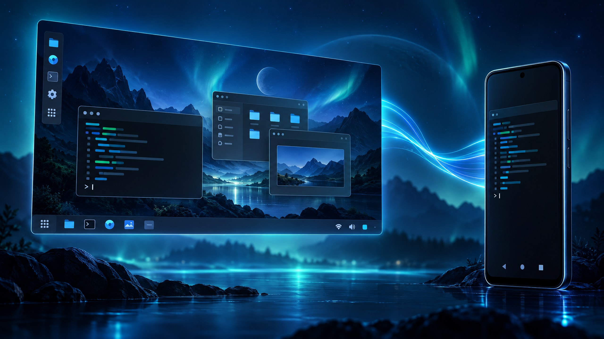

<div align="center">

# WinTerm OS

### Um desktop experimental inspirado em PC, rodando dentro do Termux.

**Debian · proot-distro · XFCE · Box64/Wine · Android**

[Instalação](#instalação) · [Como usar](#como-usar) · [Requisitos](#requisitos) · [Problemas conhecidos](#problemas-conhecidos)

</div>

<p align="center"></p>

> [!WARNING]
> **Projeto experimental — ainda não validado em aparelhos Android reais.** A instalação baixa pacotes do Termux, do Debian e de projetos externos; pode levar de 15 a 30 minutos e ocupar vários gigabytes. Leia este README antes de executar o instalador.

## O que é

WinTerm OS é um ambiente de desktop Linux instalado **dentro do Termux**, não um sistema que substitui o Android. Ele configura uma distribuição Debian isolada com `proot-distro`, o ambiente XFCE e uma interface personalizada. Também configura Box64 e Wine para tentar executar alguns programas Windows x86-64 em dispositivos ARM64; esse recurso é experimental.

## Recursos

- Debian em espaço de usuário, sem root no Android.
- Desktop XFCE com tema e wallpapers próprios inspirados em interfaces de PC.
- Duas formas de acesso: servidor VNC local ou Termux:X11.
- Box64 + Wine como recurso experimental, com execução e desempenho dependentes do aparelho e do aplicativo.
- Atalhos `winterm`, `winterm-vnc` e `winterm-stop` no Termux.

## Requisitos

- Android 8 ou superior; **dispositivo ARM64 (`aarch64`)**.
- Termux instalado por uma fonte mantida, como F-Droid ou [GitHub do Termux](https://github.com/termux/termux-app/releases). Evite misturar APKs assinados por fontes diferentes.
- Conexão com a internet durante a instalação.
- Vários GB de armazenamento livre; recomenda-se pelo menos 6 GB livres e 4 GB de RAM.
- Para a sessão gráfica via X11, o APK do [Termux:X11](https://github.com/termux/termux-x11/releases) instalado separadamente. Para VNC, um cliente VNC Android é opcional e não vem neste repositório.

> O instalador configura pacotes dentro do Termux e do Debian. Por restrições de segurança do Android, ele **não instala APKs automaticamente**. A execução de aplicativos Windows também não é garantida.

## Instalação

Abra o Termux e cole esta linha. Ela baixa o repositório oficial e inicia o instalador:

```bash
pkg update -y && pkg install -y git && git clone --depth 1 https://github.com/guirgb/Wintermx.git "$HOME/winterm-os" && cd "$HOME/winterm-os" && bash install.sh
```

O instalador solicita confirmação quando o Termux pedir, atualiza os pacotes, instala Debian via `proot-distro` e configura o ambiente. **Não execute como root e não cole o comando em outro terminal.**

## Como usar

### VNC (opção mais simples)

No Termux:

```bash
winterm-vnc
```

Conecte um cliente VNC no próprio aparelho a `127.0.0.1:5901`. Na primeira execução, será solicitado que você defina uma senha para o servidor. Para escolher outra resolução:

```bash
winterm-vnc 1920x1080
```

O servidor é configurado para aceitar conexões locais (`-localhost yes`). O áudio não é encaminhado pelo VNC; o script tenta reproduzi-lo pelo Android.

### Termux:X11

Instale e abra o APK Termux:X11 no Android e, no Termux, execute:

```bash
winterm
```

### Encerrar

```bash
winterm-stop
```

### Wine (experimental)

Dentro do desktop, abra **Configurar Wine (1º uso)** no menu Iniciar. Depois, tente executar um `.exe` com Wine. Compatibilidade, estabilidade e desempenho variam muito; jogos e programas pesados podem não funcionar.

## Atualizações e reinstalação

Para atualizar o código local sem reinstalar o Debian:

```bash
cd "$HOME/winterm-os" && git pull --ff-only
```

Não há ainda um comando próprio de atualização do sistema instalado. Reexecutar `install.sh` pode atualizar pacotes do Termux e Debian; faça backup antes de experimentar alterações.

## Problemas conhecidos

- O projeto ainda precisa de testes em aparelhos reais, inclusive validação de URLs de terceiros, pacotes e inicialização de VNC/XFCE.
- Android 12+ pode encerrar processos em segundo plano; o Termux pode oferecer um comando `termux-wake-lock`, mas isso não garante que o fabricante não limite o processo.
- A aceleração gráfica e as variáveis Zink/Turnip dependem do dispositivo, do driver e do Termux:X11.
- A arquitetura não ARM64 segue um caminho de Wine diferente e não é o alvo principal do projeto.
- A primeira instalação pode falhar se um pacote ou release externo mudar.

Se encontrar um erro, abra uma [issue](https://github.com/guirgb/Wintermx/issues) com o modelo do aparelho, versão do Android, arquitetura (`uname -m`) e o trecho final do log. **Nunca publique tokens, senhas ou dados pessoais.**

## Estrutura do projeto

```text
.
├── install.sh                 # instalador executado no Termux
├── start-winterm.sh           # inicia o desktop pelo Termux:X11
├── start-winterm-vnc.sh       # inicia o desktop por VNC
├── stop-winterm.sh            # encerra sessões
├── debian/
│   ├── setup-inside.sh        # configura o Debian e o XFCE
│   ├── theme.sh               # instala tema e configurações visuais
│   └── wine-box64.sh          # configuração opcional de Box64/Wine
└── assets/                    # wallpapers e recursos do projeto
```

## Créditos e licenças

Os temas e pacotes de terceiros são baixados de seus respectivos projetos durante a instalação e continuam sujeitos às licenças dos autores originais. Consulte `SECURITY.md` para o modelo de segurança. Este repositório ainda precisa de uma declaração de licença consolidada para os arquivos originais; não presuma que todo o conteúdo tem uma licença permissiva.

## Contribuir

Contribuições são bem-vindas. Antes de propor mudanças, consulte [`CONTRIBUTING.md`](CONTRIBUTING.md) e reporte problemas sem incluir informações privadas.

<div align="center">

Feito para experimentar, aprender e melhorar — contribuições e relatos de teste são bem-vindos.

</div>
